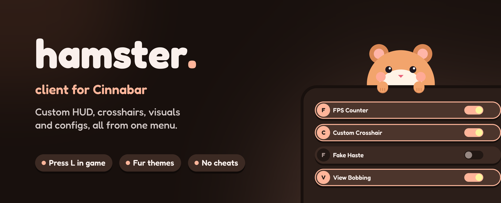
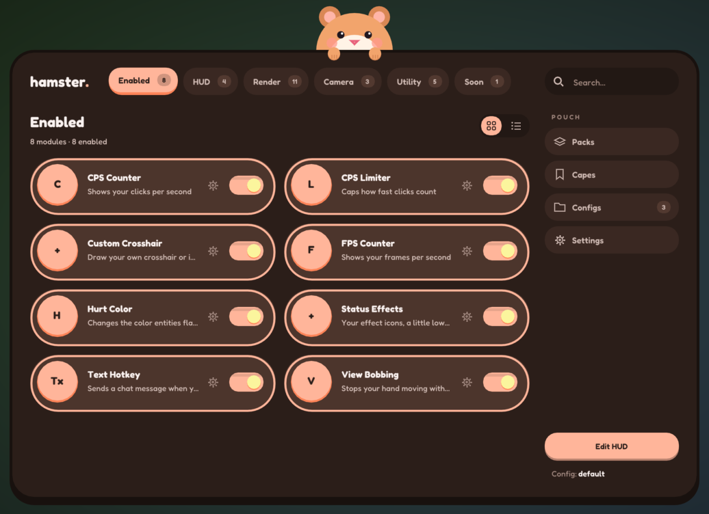
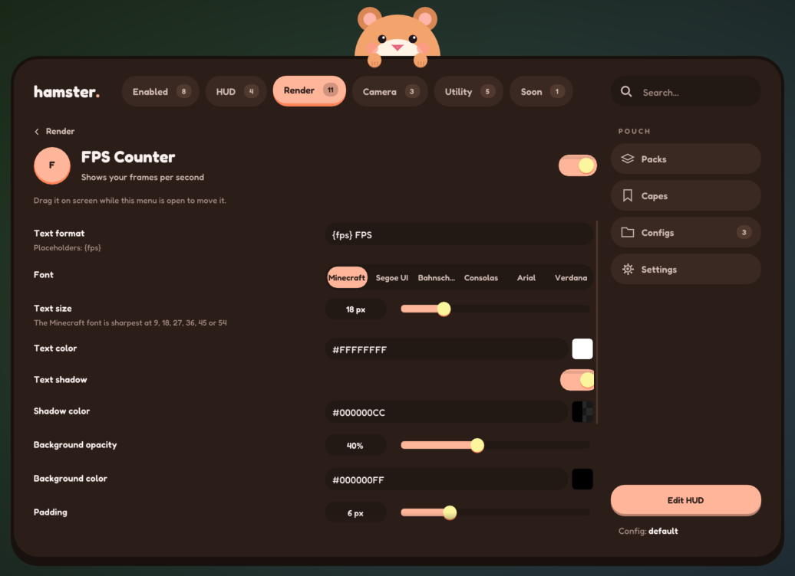
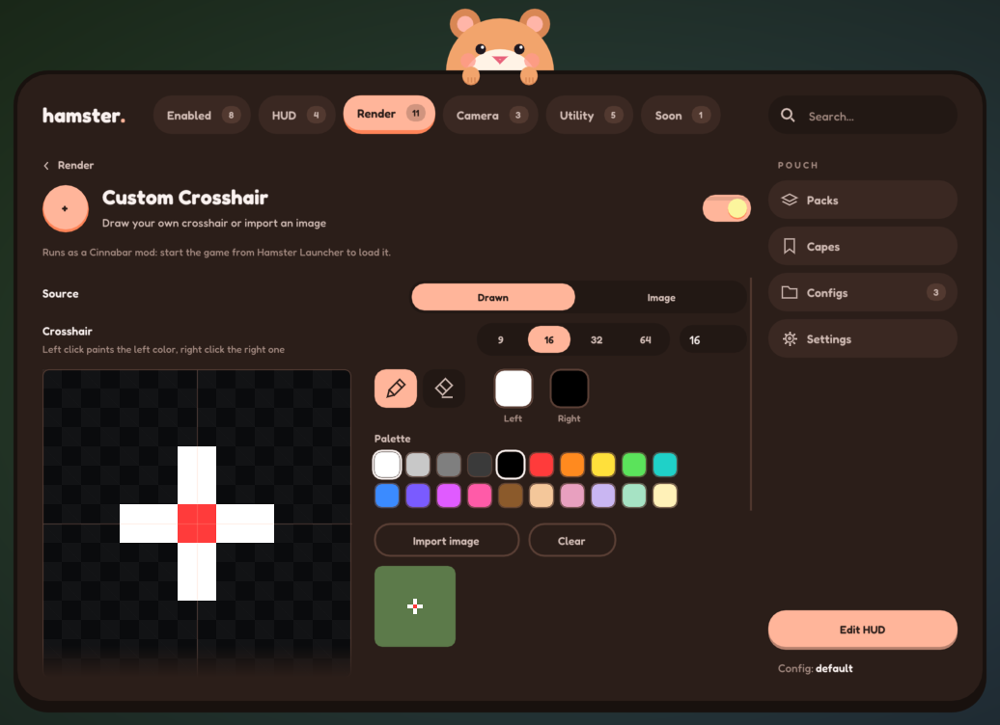
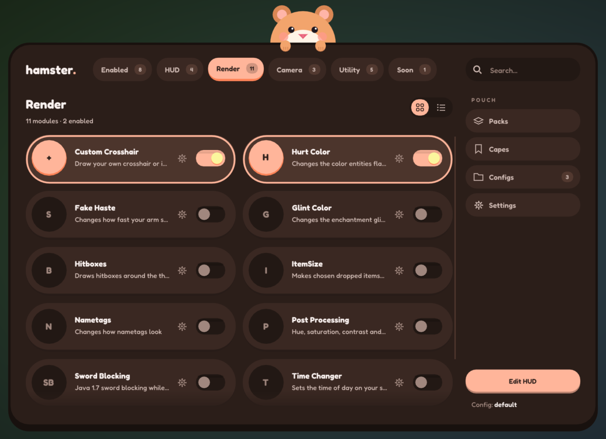
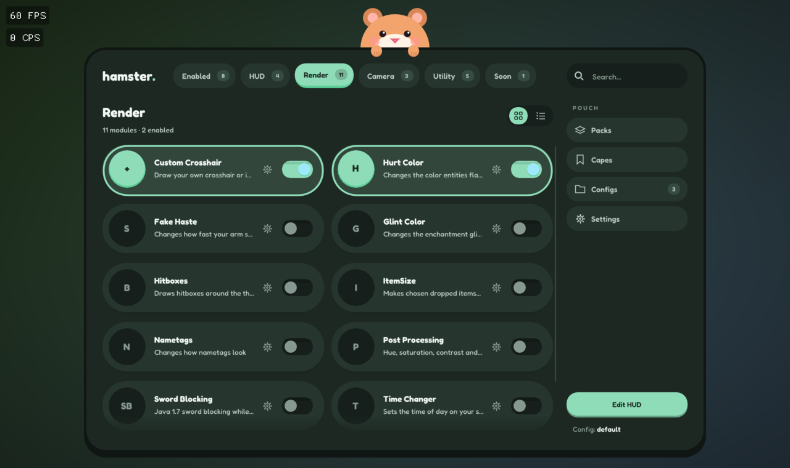

  

  

  
  
  

 

## ✦ What is Hamster Client?

Hamster Client is a quality-of-life client for [Cinnabar](https://cinnabar.gg/), the fast
Bedrock Edition client. It adds a cosy menu, a fully customizable HUD and a pile of visual
tweaks on top of the game, with **no cheats**: everything is cosmetic or a limit on your own input.

  

 

## ✦ What's new

- **A brand new menu.** Round pills, a hamster peeking over the top, and tabs for
  **Enabled · HUD · Render · Camera · Utility**. Switch between a grid and a list, or search.
- **Fur themes.** Pick Peach, Butter, Mint, Sky, Lilac or Rose, or any color with the picker.
  The whole menu and launcher recolor to match, not just the highlights.
- **HUD editor.** Drag every HUD element where you want it, snap it to lines, or right-click
  for fixed spots like top left or center bottom.
- **Crosshair editor.** Paint your crosshair pixel by pixel with a palette and two color slots,
  import a PNG, and make it inverted, chroma, or change color when you aim at something.
- **UI size.** Make the menu bigger or smaller to suit your screen.
- **New modules** that patch the game directly: **Fake Haste**, **View Bobbing**, **ItemSize**,
  **Nickname**, **Nick Others** and **Glint Color**, plus **Zoom**, **Sword Blocking**,
  **Status Effects**, **Text Hotkey** and **Command Hotkey**.
- **Configs and Packs** live in the Pouch on the right, so they're one click away.

 

## ✦ A closer look

<table>
  <tr>
    <td width="50%"></td>
    <td width="50%"></td>
  </tr>
  <tr>
    <td align="center"><b>Make the HUD yours</b> Fonts, colors, shadows, background and custom text for every element</td>
    <td align="center"><b>Draw your crosshair</b> Paint it, import a PNG, or let it change color on target</td>
  </tr>
  <tr>
    <td width="50%"></td>
    <td width="50%"></td>
  </tr>
  <tr>
    <td align="center"><b>Every module, one tap away</b> Switch it on, or open its settings with the gear</td>
    <td align="center"><b>Pick your fur</b> Six presets or any color you like</td>
  </tr>
</table>

 

## ✦ Modules

| Tab | Modules |
| --- | --- |
| **HUD** | FPS Counter · CPS Counter · Coordinates · Status Effects |
| **Render** | Custom Crosshair · Hurt Color · Glint Color · Time Changer · Weather Changer · Post Processing · Sword Blocking · Fake Haste · Hitboxes · ItemSize · Nametags |
| **Camera** | Camera Shake · Zoom · View Bobbing |
| **Utility** | CPS Limiter · Text Hotkey · Command Hotkey · Nickname · Nick Others |
| **Soon** | GUI Scale |

 

## ✦ Get started

Hamster Client is invite only: you need an **access key** to use it.

| | |
| :---: | --- |
| **1** | **Get a key.** Ask in the Hamster Discord. The Hamster bot DMs you a key like `HAM-XXXX-XXXX-XXXX-XXXX`. |
| **2** | **[Download `HamsterLauncher.exe`](../../releases/latest)** from the latest release and put it anywhere. |
| **3** | Run it and enter your key. The launcher downloads Hamster Client and keeps it up to date by itself. |
| **4** | Press **Launch**. It opens Cinnabar for you with everything loaded. |
| **5** | Press **`L`** in game to open the menu. You can change the key in **Settings**. |

> [!NOTE]
> Windows may show a "Windows protected your PC" screen the first time, because the app is new and
> unsigned. Click **More info**, then **Run anyway**.

 

## ✦ FAQ

<b>How do access keys work?</b>

 
A key works on one PC. The first time you enter it, it's tied to that PC, and it lasts 7 days from
then. When it runs out, ask for more time or a new key. If you reinstall Windows or move to a new
PC, ask for your key to be reset.

<b>Is it a cheat?</b>

 
No. Every module is visual (HUD, colors, crosshair, camera) or limits your own clicks. Hamster Client
never gives you information or abilities the game doesn't.

<b>Can I get banned for using it?</b>

 
Cinnabar itself warns that some servers may flag non-vanilla clients, and that goes for any client
running on top of it too. Play on servers that allow it.

<b>The menu doesn't show up</b>

 
Close Cinnabar and start it from <b>Hamster Launcher</b>, which runs the game on DirectX 12. If it
still doesn't work, send <code>%APPDATA%\HamsterClient\hamster.log</code> in the Discord.

<b>A module says it isn't patched into this Cinnabar build yet</b>

 
Some modules hook into the game itself and need to know where things are in each Cinnabar version.
That list updates every day, so after a Cinnabar update give it a day and start the game from
Hamster Launcher again.

<b>Where are my settings saved?</b>

 
In <code>%APPDATA%\HamsterClient</code>. Each config is its own file, so you can back them up or share them.

 

  Hamster Client is not affiliated with Cinnabar, Mojang or Microsoft. Minecraft is a trademark of Microsoft Corporation.

