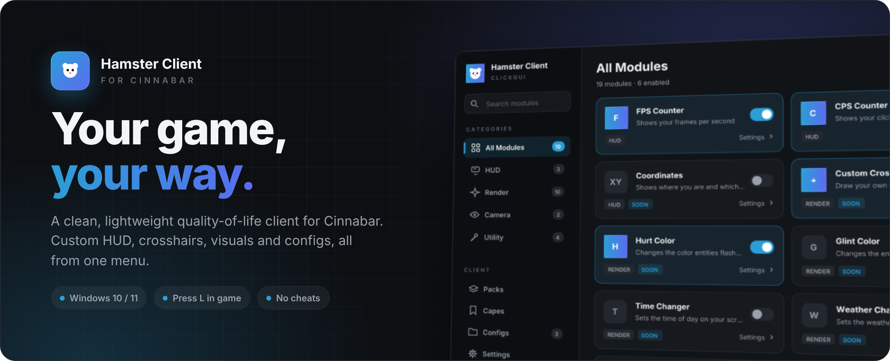
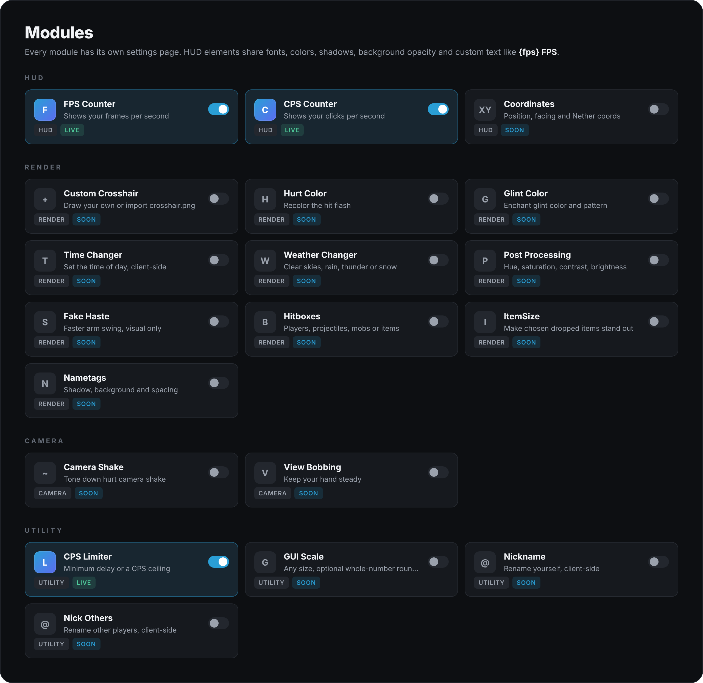
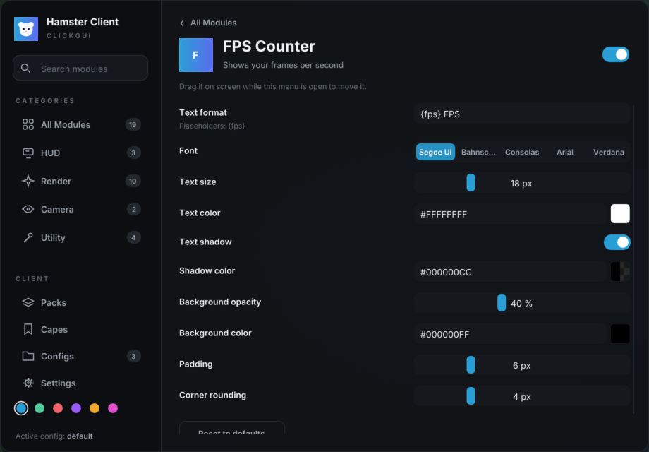
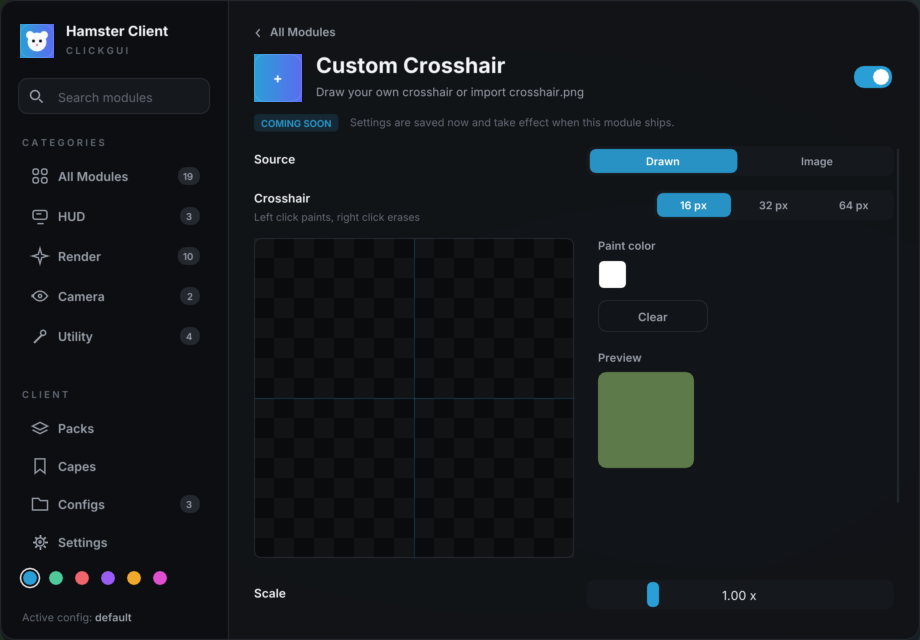

  

  

  
  
  
  

 

## ✦ What is Hamster Client?

Hamster Client is a quality-of-life add-on for [Cinnabar](https://cinnabar.gg/), the fast
Bedrock Edition client. It adds a clean menu, a fully customizable HUD and visual tweaks on top
of the game, with **no cheats**: everything is cosmetic or a limit on your own input.

 

  

 

## ✦ A closer look

<table>
  <tr>
    <td width="50%"></td>
    <td width="50%"></td>
  </tr>
  <tr>
    <td align="center"><b>Make the HUD yours</b> Fonts, colors, shadows, background and custom text for every element</td>
    <td align="center"><b>Draw your crosshair</b> Paint it pixel by pixel or import your own <code>crosshair.png</code></td>
  </tr>
</table>

 

## ✦ Get started

| | |
| :---: | --- |
| **1** | **[Download the latest release](../../releases/latest)** and unzip it anywhere. Keep `HamsterClient.exe` and `hamster.dll` together. |
| **2** | In Cinnabar, open **Settings** and set **Graphics API** to **Automatic** or **DirectX 12**. |
| **3** | Run **`HamsterClient.exe`**. It opens Cinnabar for you, or attaches if it's already running. |
| **4** | Press **`L`** in game to open the menu. You can change the key in **Settings**. |

> [!NOTE]
> Windows may show a "Windows protected your PC" screen the first time, because the app is new and
> unsigned. Click **More info**, then **Run anyway**.

 

## ✦ FAQ

<b>Is it a cheat?</b>

 
No. Every module is visual (HUD, colors, crosshair, camera) or limits your own clicks. Hamster Client
never gives you information or abilities the game doesn't.

<b>Can I get banned for using it?</b>

 
Cinnabar itself warns that some servers may flag non-vanilla clients, and that goes for any client
running on top of it too. Play on servers that allow it.

<b>The menu doesn't show up</b>

 
Make sure Cinnabar's Graphics API is set to <b>Automatic</b> or <b>DirectX 12</b>, then run
<code>HamsterClient.exe</code> again. If it still doesn't work, open an issue and attach
<code>%APPDATA%\HamsterClient\hamster.log</code>.

<b>Where are my settings saved?</b>

 
In <code>%APPDATA%\HamsterClient</code>. Each config is its own file, so you can back them up or share them.

 

  Hamster Client is not affiliated with Cinnabar, Mojang or Microsoft. Minecraft is a trademark of Microsoft Corporation.

